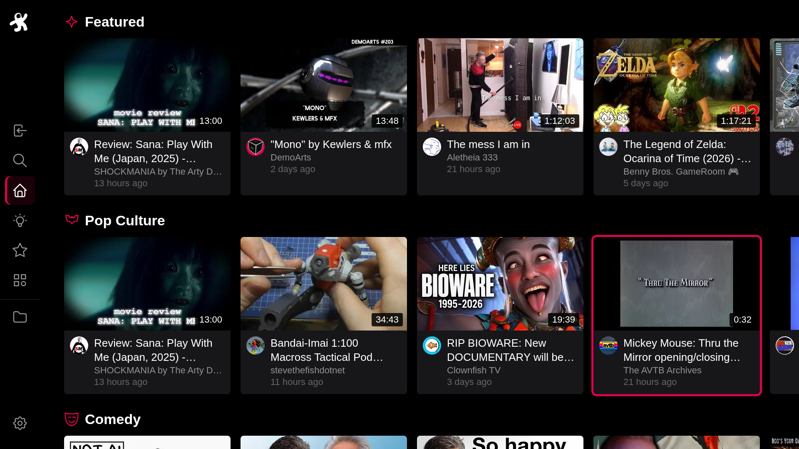
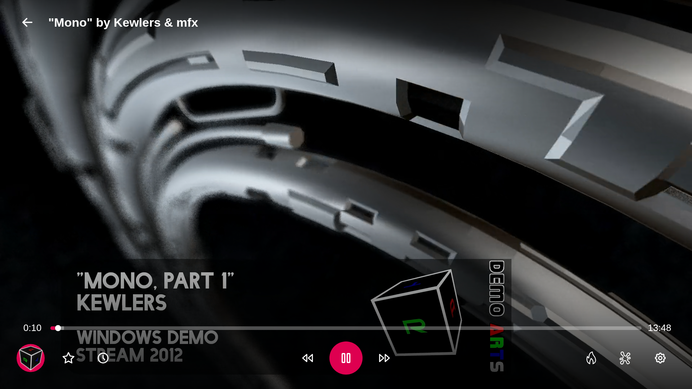

# Odysee for webOS

[](https://github.com/Saulimedes/odysee-webos/actions/workflows/main.yml)
[](https://github.com/Saulimedes/odysee-webos/actions/workflows/release.yml)
[](LICENSE)

Unofficial Odysee client for LG webOS TVs.





## Features

- Home like on Odysee, with Continue Watching and one row per category.
- Search with filters, Categories, channels, Library, Playlists and Following. Sign in to sync Watch Later, Favorites and Following.
- Hold OK on a video to save it, remove it from your lists or open its channel.
- Player with aspect ratio, speed and Stats for Nerds. Autoplay goes on with the next video of the list you started from, or a related one.
- Plays the transcoded stream that Odysee makes of a video, like odysee.com does, and the original file when there is none or the server will not hand it out.
- Themes, fonts and sizes, a customizable homepage and menu, 9 languages.
- Made for the TV remote, the Magic Remote pointer works too.

## Installation

You can install the app using one of the following methods:

- **[webOS Homebrew Channel](https://github.com/webosbrew/webos-homebrew-channel):** Odysee is not in the official [webOS Brew repository](https://repo.webosbrew.org/) yet. Once it is listed, it will be available at `https://repo.webosbrew.org/apps/org.webosbrew.odysee/` and installs and updates from the Homebrew Channel on the TV.
- **[Device Manager](https://github.com/webosbrew/dev-manager-desktop):** Use the pre-built `.ipk` file from the [Releases](https://github.com/Saulimedes/odysee-webos/releases) page.
- **Command Line (webOS CLI):** Build it and install it yourself, see [Deploy to the TV](#deploy-to-the-tv).

The target is Chrome 68 (webOS 5). The production build uses ES2019 syntax or older, `npm run build` checks that, and `npm run test:chrome68` runs the app in a real Chrome 68.

## Development

Node 24 is used for everything except packaging (see `.nvmrc`).

```bash
npm ci
npm start          # dev server on http://localhost:3333
npm run verify     # typecheck, FSD lint, unused code, tests, build and Chrome 68
```

The dev server also loads hls.js, so browsers without HLS of their own (Firefox) play the transcoded streams. Chrome, Safari and the TV play them natively and the production build does not contain hls.js.

### Deploy to the TV

Enable Developer Mode on the TV and add it with `ares-setup-device`, then run `npm run build`, `npm run package`, `npm run deploy` and `npm run launch`. `npm run package` runs `ares-package` on Node 20, because newer Node writes every file with timestamp 0 and webOS then refuses the ipk.

## Credits

- Uses the [LBRY](https://lbry.com) and [Odysee](https://odysee.com) APIs.
- Customization, the webOS aspect ratio and playback speed services, and tooling follow [cccbib](https://github.com/volkovmqx/cccbib).
- Built with React and Tabler icons. Fonts are under the SIL Open Font License, see `src/app/styles/fonts`.
- The Odysee name and the Odysee astronaut logo belong to their owners. This is an unofficial app and is not affiliated with Odysee. For the rights to the logo, see [Odysee Logo on Wikipedia](https://de.wikipedia.org/wiki/Datei:Odysee_Logo.svg).

## License

[GPL-3.0](LICENSE)
